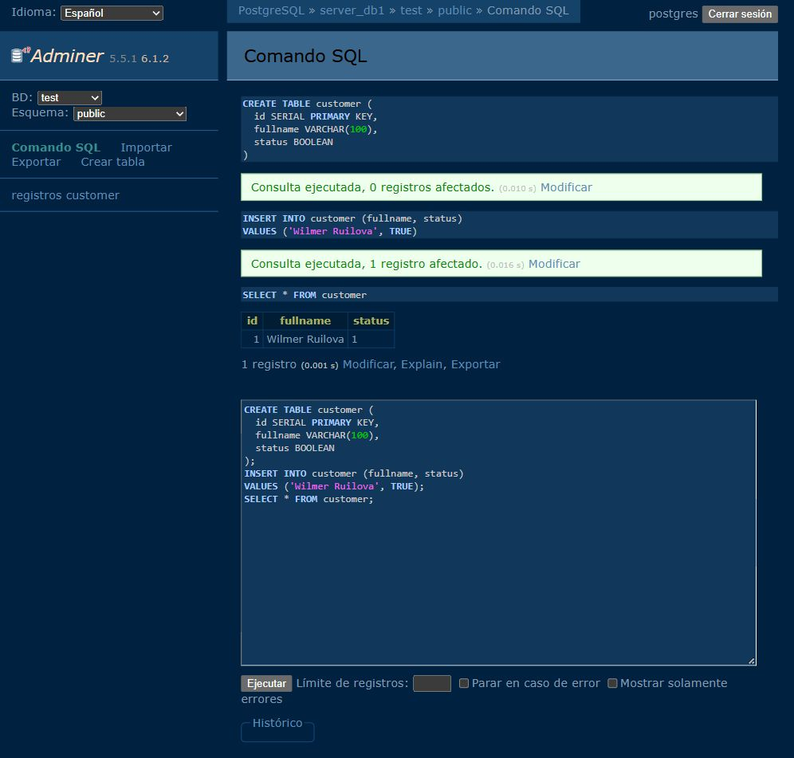
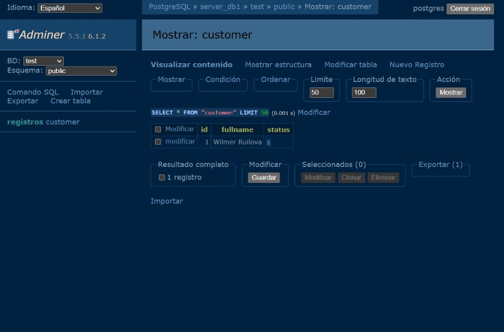
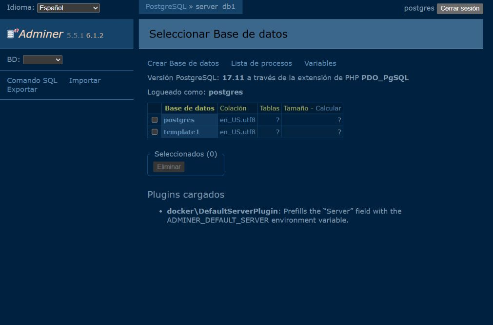
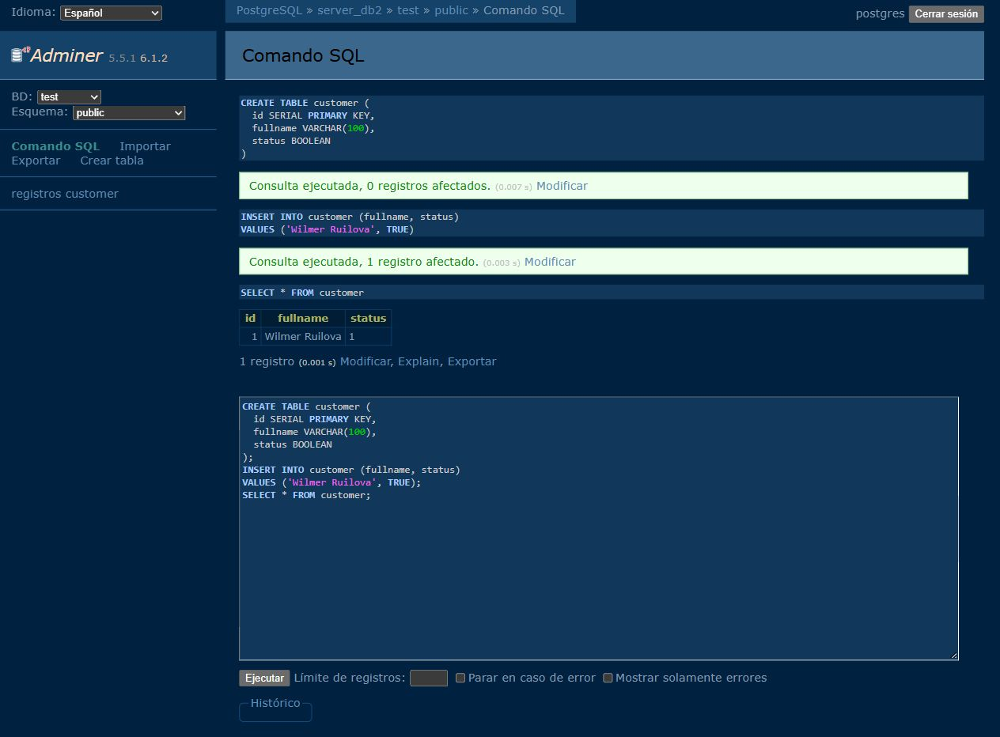
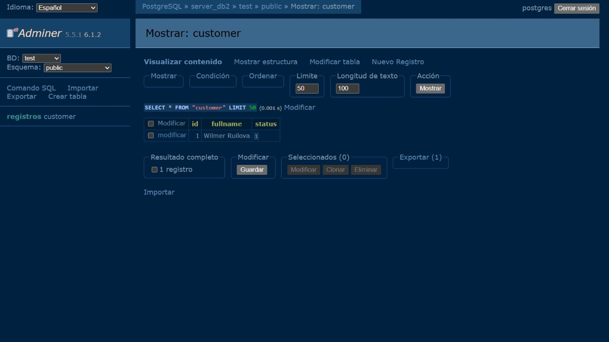

# 1. Título

Práctica 3: PostgreSQL y volúmenes en Docker

Estudiante: Wilmer Alexander Ruilova Merchan

Materia: Tendencias Tecnológicas

Docente: Marco Guaman

Fecha: 20 de octubre de 2026

## 2. Tiempo de duración

Las pruebas de los contenedores y la comprobación de los datos tomaron aproximadamente 5 minutos. Este tiempo no incluye el estudio del tema ni la grabación del audio.

## 3. Fundamentos

PostgreSQL es un sistema de base de datos relacional. La información se organiza en tablas, donde cada fila representa un registro y cada columna guarda un dato. En esta práctica, la base se llama `test` y contiene la tabla `customer`. No son lo mismo: la base es el conjunto donde se crean las tablas, mientras que la tabla tiene una estructura concreta para guardar información.

La tabla utilizada tiene tres campos. `id` identifica cada registro; al declararlo como `SERIAL PRIMARY KEY`, PostgreSQL genera su valor y evita identificadores repetidos. `fullname` guarda el nombre como texto, con un máximo de cien caracteres. `status` es un booleano, por lo que representa un valor verdadero o falso. Esto permite guardar información con tipos adecuados en lugar de escribir todo como texto.

SQL sirve para indicar qué se quiere hacer en la base. `CREATE DATABASE` crea una base de datos y `CREATE TABLE` define una tabla. Con `INSERT INTO` se agrega una fila y con `SELECT` se consulta su contenido. Para trabajar con estos comandos se utilizó Adminer, un administrador que funciona en el navegador. Desde allí se puede elegir el servidor, seleccionar la base y comprobar los registros. Estos conceptos se explican en la documentación de PostgreSQL indicada en la bibliografía.

Docker permite iniciar PostgreSQL a partir de una imagen. El contenedor ejecuta el servidor, pero su nombre no determina dónde se guardan los datos. Por eso crear otro contenedor llamado igual no significa recuperar automáticamente la base anterior.

Un volumen con nombre, como `pgdata`, guarda los archivos de PostgreSQL en un almacenamiento administrado por Docker. Al eliminar el contenedor se puede conservar ese volumen y conectarlo al siguiente. Para PostgreSQL 17, se montó en `/var/lib/postgresql/data`, que es la ubicación usada por esta imagen para sus datos.

Hay un detalle en la primera prueba: aunque no se indicó un volumen con nombre, la imagen creó uno anónimo. Se eliminó junto al contenedor con `docker rm -v`. En la segunda prueba se conservó `pgdata`. La diferencia está en reutilizar el almacenamiento, no solamente en detener o iniciar el servidor. Un volumen tampoco reemplaza una copia de seguridad: si se elimina o se dañan sus datos, hace falta un respaldo aparte. Esta distinción se apoya en la documentación de Docker.

## 4. Conocimientos previos

- Abrir Ubuntu WSL y usar comandos básicos de la terminal.
- Crear y detener contenedores con Docker.
- Distinguir una imagen de un contenedor.
- Reconocer una base de datos, una tabla y un registro.

## 5. Objetivos

- Crear dos servidores PostgreSQL y conectarlos a un administrador de bases de datos.
- Crear la base `test`, la tabla `customer` y un registro en cada servidor.
- Comparar los datos después de eliminar y recrear los contenedores.

## 6. Equipo necesario

Computadora con Windows, Ubuntu WSL 24.04.4 LTS, Docker 29.1.3 y navegador web. Se utilizaron PostgreSQL 17.11 y Adminer 5.5.1 mediante las imágenes `postgres:17` y `adminer:5`.

## 7. Material de apoyo

Indicaciones de TAS3 en el EVA, video de clase `s3-volumenes-con-docker.mp4`, plantilla del docente y documentación de Docker y PostgreSQL. Los enlaces se encuentran al final.

## 8. Procedimiento

Se revisó el procedimiento con el video de clase: crear PostgreSQL, comprobar los datos y repetir la prueba conservando un volumen. El video usa DataGrip; aquí se usó Adminer. Los nombres de los contenedores, la base y la tabla son los que pide TAS3.

### 1. Preparar la conexión

En Ubuntu se creó una red para que Adminer pudiera encontrar los servidores por su nombre:

```bash
docker network create tas3_red
docker run -d --name adminer_tas3 --network tas3_red \
  -p 127.0.0.1:8088:8080 adminer:5
```

Se guardaron `POSTGRES_USER=postgres` y una contraseña local en `postgres.env`. El archivo se usa con `--env-file` y no se incluye en el repositorio porque contiene la contraseña.

### 2. Crear server_db1 sin un volumen con nombre

```bash
docker run -d --name server_db1 --network tas3_red \
  -p 127.0.0.1:5433:5432 --env-file postgres.env postgres:17
```

Se abrió `http://localhost:8088`. En Adminer se seleccionó PostgreSQL, servidor `server_db1`, usuario `postgres`, la contraseña local y base inicial `postgres`.

### 3. Crear test y customer

En **Comando SQL** se ejecutó:

```sql
CREATE DATABASE test;
```

Después se seleccionó `test` en la lista de bases y se ejecutó:

```sql
CREATE TABLE customer (
  id SERIAL PRIMARY KEY,
  fullname VARCHAR(100),
  status BOOLEAN
);

INSERT INTO customer (fullname, status)
VALUES ('Wilmer Ruilova', TRUE);

SELECT * FROM customer;
```



Figura 1. Creación de la tabla e inserción del registro en `server_db1`.



Figura 2. El registro existe antes de eliminar el primer contenedor.

### 4. Eliminar y recrear server_db1

```bash
docker stop server_db1
docker rm -v server_db1
docker run -d --name server_db1 --network tas3_red \
  -p 127.0.0.1:5433:5432 --env-file postgres.env postgres:17
```

La opción `-v` eliminó el volumen anónimo de este contenedor de prueba. Al volver a entrar a `server_db1` desde Adminer, `test` ya no aparecía en la lista.



Figura 3. Después de recrear `server_db1`, se muestran `postgres` y `template1`, pero no `test`.

### 5. Crear pgdata y server_db2

```bash
docker volume create pgdata
docker run -d --name server_db2 --network tas3_red \
  -p 127.0.0.1:5434:5432 --env-file postgres.env \
  -v pgdata:/var/lib/postgresql/data postgres:17
```

En Adminer se inició sesión en `server_db2` con el mismo usuario y contraseña. Se ejecutó `CREATE DATABASE test;`, se seleccionó esa base y se repitieron los comandos de creación de `customer`, inserción y consulta del paso 3.



Figura 4. La segunda base también contiene la tabla con sus tres campos.


Figura 5. Registro de `server_db2` antes de eliminar el contenedor.

### 6. Recrear server_db2 con el mismo volumen

```bash
docker stop server_db2
docker rm server_db2
docker run -d --name server_db2 --network tas3_red \
  -p 127.0.0.1:5434:5432 --env-file postgres.env \
  -v pgdata:/var/lib/postgresql/data postgres:17
```

No se eliminó `pgdata`. Se actualizó la consulta de `customer` en Adminer y el registro seguía disponible, sin ejecutar otra vez `CREATE DATABASE`, `CREATE TABLE` ni `INSERT`.



Figura 6. La base, la tabla y el registro se conservaron después de recrear `server_db2`.

## 9. Resultados

| Prueba | Antes de eliminar | Después de recrear |
|---|---|---|
| `server_db1`, sin reutilizar almacenamiento | `test` y un registro en `customer` | `test` no existe |
| `server_db2`, reutilizando `pgdata` | `test` y un registro en `customer` | La misma base, tabla y registro siguen disponibles |

Las figuras 3 y 6 muestran la diferencia. También se comprobó desde `psql`: en `server_db1`, la búsqueda de `test` devolvió cero coincidencias; en `server_db2`, la consulta devolvió `1 | Wilmer Ruilova | t`. Adminer muestra ese estado verdadero como `1`.

Lo principal es que el contenedor se puede reemplazar y los datos pueden seguir ahí si se conserva y reutiliza su volumen. Usar el mismo nombre del contenedor no basta. El volumen `pgdata` quedó guardado para poder revisar nuevamente la práctica.

## 10. Bibliografía

- Docker, Inc. (s. f.). *Volumes*. Docker Docs. https://docs.docker.com/engine/storage/volumes/
- Docker Official Images. (s. f.). *Postgres*. Docker Hub. https://hub.docker.com/_/postgres
- Docker Official Images. (s. f.). *Adminer*. Docker Hub. https://hub.docker.com/_/adminer
- PostgreSQL Global Development Group. (s. f.). *Creating a new table*. PostgreSQL 17 Documentation. https://www.postgresql.org/docs/17/tutorial-table.html
- PostgreSQL Global Development Group. (s. f.). *CREATE DATABASE*. PostgreSQL 17 Documentation. https://www.postgresql.org/docs/17/sql-createdatabase.html
- Guaman, M. (s. f.). *Plantilla de informe de Tendencias Tecnológicas*. GitHub. https://github.com/maguaman2/informe-tendencias
- *s3-volumenes-con-docker* [Video de clase]. (s. f.). Material de Tendencias Tecnológicas en EVA.
